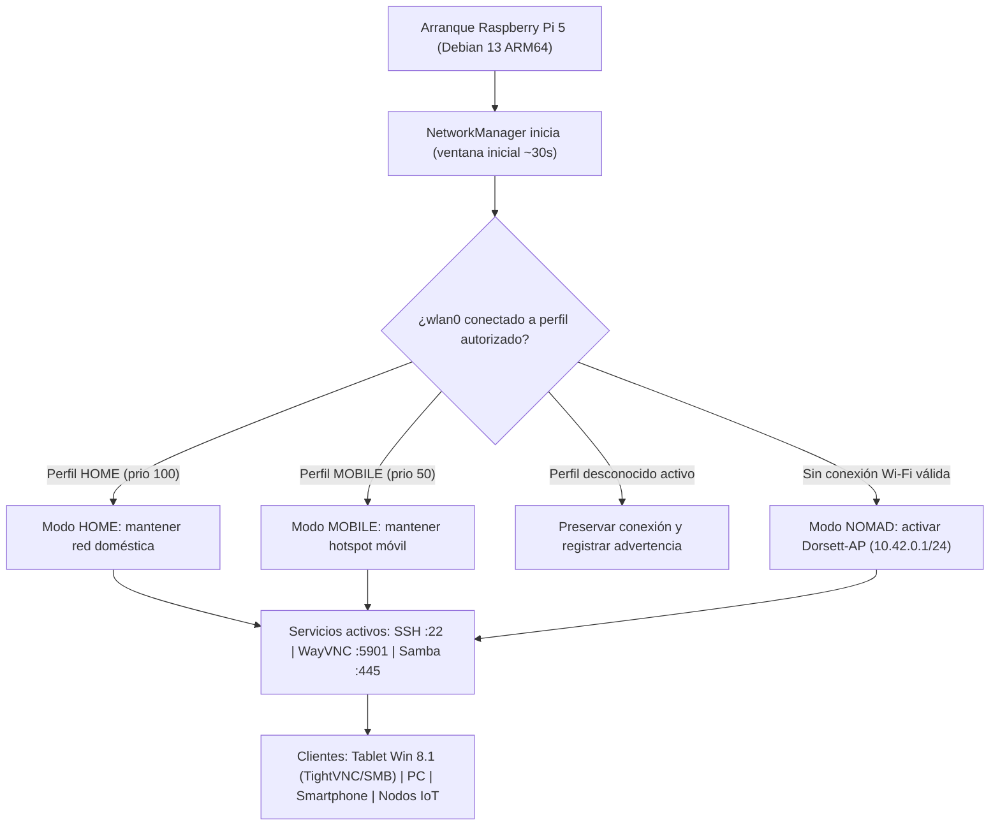

# Proyecto Dorsett — CyberDeck Modular y Ecosistema LAN Offline

> *"La cyberdeck representa soberanía tecnológica aplicada: una herramienta reparable, entendible, expandible, autónoma y alineada con necesidades reales."*

**Proyecto Dorsett** (`dorsett-cyberdeck`) es una CyberDeck modular basada en **Raspberry Pi 5**, perteneciente al ecosistema tecnológico **QuasarPunk**. Está concebida como una computadora portátil reparable, autónoma, expandible y orientada a la soberanía tecnológica, con operación *offline-first*.

Más allá de actuar como estación personal portátil y servidor Linux *headless*, Dorsett opera como nodo central de control, telemetría, administración remota y almacenamiento NAS (Samba) para proyectos de robótica móvil, mecatrónica, hidroponía automatizada (**GreenNode**) e inteligencia artificial local (**Scio**).

---

## Filosofía y objetivos

### Principios de desarrollo

- **Offline-first:** operación completa en red local sin dependencia de Internet ni servicios en la nube.
- **Modularidad y reparabilidad:** arquitectura desacoplada de hardware y software fácil de mantener e inspeccionar.
- **Software libre y reproducibilidad:** herramientas estándar de Linux, NetworkManager y systemd, con documentación continua.
- **Compatibilidad con hardware reutilizado:** soporte para terminales existentes, como tabletas con Windows 8.1 de 32 bits vía TightVNC.
- **Desarrollo incremental basado en pruebas reales:** ninguna funcionalidad se declara validada en producción sin verificación física sobre la Raspberry Pi 5.

### Objetivos principales

- Consolidar una infraestructura LAN autónoma sin requerir salida a Internet.
- Mantener acceso remoto confiable mediante SSH, WayVNC y Samba desde tablet, PC de escritorio y smartphone.
- Incorporar conectividad resiliente en tres modos (`HOME`, `MOBILE` y `NOMAD`) con conmutación controlada y respaldo al arrancar (*v0.4.0 — Nomad Update*, actualmente implementado en código y pendiente de validación en hardware real).
- Separar explícitamente la **autonomía de red** (en desarrollo en `v0.4.0`) de la **autonomía energética** (planificada para etapas posteriores con baterías y gestión de energía).

---

## Características actuales

- **Acceso remoto por terminal:** servicio `ssh` activo en el puerto TCP `22`.
- **Escritorio remoto Wayland/labwc:** servicio de usuario `wayvnc-lan.service` en el puerto TCP `5901` (compatible con TightVNC en Windows 8.1 de 32 bits), preservando la instancia secundaria en el puerto TCP `5900`.
- **Almacenamiento local NAS:** servidor `smbd` (Samba) en el puerto TCP `445` compartiendo el directorio de usuario configurado (`~/compartido`).
- **Descubrimiento mDNS:** `avahi-daemon` activo para resolución local (`.local`), manteniendo la conexión por IP como método de referencia.
- **Priorización de red doméstica:** `NetworkManager` activo con prioridad máxima (`100`) para el perfil autorizado de red local.
- **Infraestructura Nomad Update (en preparación):** scripts `dorsett-network`, `setup-hotspot`, `collect-diagnostics`, unidad `dorsett-fallback.service` y plan de pruebas simuladas listos para fase de despliegue controlado.

---

## Inventario de hardware

| Componente | Modelo / Referencia | Rol en el sistema | Estado |
| :--- | :--- | :--- | :--- |
| **SBC principal** | Raspberry Pi 5 (ARM64) | Cómputo central, servidor *headless* y NAS | Confirmado (operativo) |
| **Terminal remoto** | Tablet X-View Quantum Carbono (Windows 8.1 32-bit) | Pantalla remota y control táctil vía TightVNC | Reportado (operativo) |
| **Teclado** | Teclado ultracompacto Noga | Entrada de texto | Reportado (operativo) |
| **Mouse** | Mouse óptico Noga | Dispositivo apuntador | Reportado (operativo) |
| **Smartphone** | Samsung Galaxy A10 | Hotspot móvil (`MOBILE`) y cliente LAN | Reportado (operativo) |
| **Estación de desarrollo** | PC de escritorio | Desarrollo, administración SSH y monitoreo | Reportado (operativo) |
| **Coprocesador I/O** | Arduino UNO | Futuras funciones de entrada/salida y sensores | Planificado |
| **Alimentación portátil** | Sistema de batería y gestión energética | Autonomía eléctrica móvil | Planificado |

Para el detalle completo de estado y verificación, consultar [docs/TECHNICAL_CONTEXT.md](docs/TECHNICAL_CONTEXT.md) y [hardware/BOM.md](hardware/BOM.md).

---

## Arquitectura general y modos de conectividad

Dorsett utiliza `NetworkManager` como único gestor de red y organiza la conectividad inalámbrica (`wlan0`) en **tres modos oficiales**, evitando ejecutar cliente y Access Point simultáneamente en la misma radio en esta versión:

| Modo | Rol de `wlan0` | Prioridad / Activación | Direccionamiento típico | Propósito |
| :--- | :--- | :--- | :--- | :--- |
| **`HOME`** | Cliente Wi-Fi | Autoconexión, prioridad `100` | DHCP en LAN doméstica (ej. `192.168.1.x`) | Desarrollo, acceso local completo y sincronización opcional |
| **`MOBILE`** | Cliente Wi-Fi | Autoconexión, prioridad `50` | DHCP del hotspot del smartphone | Operación en campo vinculada al teléfono |
| **`NOMAD`** | Access Point (`Dorsett-AP`) | Sin autoconexión; activación manual o *fallback* al arrancar | `10.42.0.1/24` (`ipv4.method shared` + `dnsmasq`) | Autonomía de red total sin router externo ni Internet |



---

## Estado de implementación

| Capacidad / Versión | Estado actual | Observaciones |
| :--- | :--- | :--- |
| **v0.1.0 — Remote Access Foundation** | Confirmado en hardware | SSH (`22`), WayVNC (`5900`/`5901`), `wayvnc-lan.service` y acceso desde Tablet Windows 8.1 |
| **v0.2.0 — Local Network Ecosystem** | Confirmado / Reportado | Samba (`445`) operativo sobre directorio compartido e integración multi-dispositivo |
| **v0.3.0 — Network Stability** | Confirmado en auditoría | Priorización del perfil doméstico (`100`) y auditoría del sistema (2026-11-24) |
| **v0.4.0 — Nomad Update (Red)** | Implementado en repo (sin validar en Pi) | Scripts, unidad systemd y pruebas simuladas listos; el modo `NOMAD` **no** está declarado completo hasta superar pruebas reales |
| **Autonomía energética** | Planificado | Pendiente de diseño de alimentación por baterías y gestión térmica (etapas v0.8.0–v0.9.0) |

> **Nota importante sobre autonomía:** la actualización `v0.4.0` resuelve la **autonomía de red** (operar sin router externo), pero la **autonomía energética** de la CyberDeck sigue pendiente de implementación física.

---

## Estructura del repositorio

```text
dorsett-cyberdeck/
├── README.md                              # Visión general y navegación del proyecto
├── AGENTS.md                              # Reglas permanentes para agentes de IA y colaboradores
├── CHANGELOG.md                           # Registro histórico de hitos y cambios
├── ROADMAP.md                             # Planificación evolutiva por versiones
├── LICENSE                                # Propuesta de licencia MIT para software
├── .gitignore                             # Exclusiones de secretos, logs e informes locales
├── docs/
│   ├── TECHNICAL_CONTEXT.md               # Memoria técnica viva del sistema
│   ├── ARCHITECTURE.md                    # Arquitectura integral de hardware y software
│   ├── NETWORKING.md                      # Diseño detallado de modos HOME, MOBILE y NOMAD
│   ├── INSTALLATION.md                    # Procedimiento de despliegue controlado y recuperación
│   ├── TROUBLESHOOTING.md                 # Incidencias conocidas y guías de diagnóstico
│   ├── SECURITY.md                        # Política de seguridad y hardening
│   ├── decisions/
│   │   └── ADR-001-network-modes.md       # Decisión arquitectónica sobre modos de red
│   └── audits/
│       └── 2026-11-24-system-audit.md     # Registro histórico de la auditoría técnica
├── software/
│   ├── scripts/
│   │   ├── dorsett-network.sh             # CLI de gestión de red y fallback
│   │   ├── setup-hotspot.sh               # Configuración segura del perfil Dorsett-AP
│   │   └── collect-diagnostics.sh         # Recopilación sanitaria de diagnósticos
│   ├── systemd/
│   │   └── dorsett-fallback.service       # Unidad systemd de respaldo al arranque
│   └── config/
│       └── network.env.example            # Plantilla de configuración local
├── tests/
│   ├── network-test-plan.md               # Matriz de escenarios T01–T19
│   └── test-network.sh                    # Suite automatizada con mocks de nmcli
├── firmware/                              # Reservado para futuros firmwares (Arduino / MCU)
├── hardware/
│   ├── models/                            # Reservado para futuros modelos 3D
│   ├── schematics/                        # Reservado para futuros esquemas eléctricos
│   └── BOM.md                             # Inventario de materiales (confirmado y planificado)
└── assets/
    ├── images/                            # Recursos visuales del proyecto
    └── diagrams/                          # Diagramas complementarios
```

---

## Navegación por la documentación

1. Si eres nuevo en el proyecto o colaboras con asistencia automatizada, lee primero [AGENTS.md](AGENTS.md) y la memoria técnica en [docs/TECHNICAL_CONTEXT.md](docs/TECHNICAL_CONTEXT.md).
2. Para comprender el diseño del sistema y las decisiones tomadas, consulta [docs/ARCHITECTURE.md](docs/ARCHITECTURE.md), [docs/NETWORKING.md](docs/NETWORKING.md) y [docs/decisions/ADR-001-network-modes.md](docs/decisions/ADR-001-network-modes.md).
3. Antes de desplegar cambios en la Raspberry Pi 5 real, revisa [docs/SECURITY.md](docs/SECURITY.md), [docs/INSTALLATION.md](docs/INSTALLATION.md) y [tests/network-test-plan.md](tests/network-test-plan.md).
4. Si encuentras anomalías (como advertencias en WayVNC o problemas de DHCP), consulta [docs/TROUBLESHOOTING.md](docs/TROUBLESHOOTING.md) y ejecuta `software/scripts/collect-diagnostics.sh`.

## Instalación en Raspberry Pi

Desde la raíz de la copia del repositorio en la Pi, ejecuta `bash install.sh --check` y luego `sudo bash install.sh`. Configura el perfil HOME local y valida el AP con recuperación temporizada antes de habilitar el fallback. [Guía de instalación y prueba](docs/INSTALLATION.md)

---

## Roadmap resumido

- **v0.1.0 – v0.3.0:** acceso remoto (SSH/WayVNC), NAS Samba y estabilidad de perfil doméstico *(completado)*.
- **v0.4.0 (en curso):** *Nomad Update* — modos `HOME`/`MOBILE`/`NOMAD`, *fallback* al arranque y herramientas de diagnóstico.
- **v0.5.0 – v0.6.0:** recuperación dinámica ante caídas de red e interfaz gráfica de administración.
- **v0.7.0 – v1.0.0:** nodos IoT (GreenNode, robótica), chasis modular con disipación térmica, alimentación por baterías e integración CyberDeck autónoma.
- **Largo plazo:** IA local con Ollama + Piper TTS (**Scio**), autenticación física NFC/RFID, cifrado de almacenamiento y modo `BRIDGE` multi-radio.

Consulta el detalle completo en [ROADMAP.md](ROADMAP.md) y el historial en [CHANGELOG.md](CHANGELOG.md).

---

## Licencia y organización

Proyecto desarrollado dentro del ecosistema **QuasarPunk**.
El código y la documentación de este repositorio cuentan con una propuesta de licencia **MIT** en [LICENSE](LICENSE), pendiente de confirmación formal del titular de derechos. La licencia aplicable a futuros diseños físicos de hardware se definirá cuando existan artefactos publicados.
