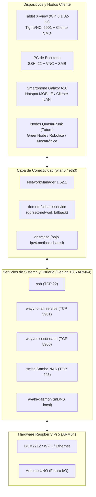

# Arquitectura del Sistema — Proyecto Dorsett

Este documento describe la arquitectura integral de **Proyecto Dorsett** (`dorsett-cyberdeck`), abarcando hardware, sistema operativo, servicios base, gestión de red `v0.4.0` e integración prevista dentro del ecosistema **QuasarPunk**.

---

## 1. Visión general por capas

---

## 2. Arquitectura de hardware

- **Unidad de cómputo:** Raspberry Pi 5 (`ARM64`, hostname `raspi-ali`).
- **Operación *headless*:** la Raspberry Pi no depende de un monitor HDMI dedicado en operación diaria; su interfaz gráfica y consola se consumen por red desde la **Tablet X-View Quantum Carbono** (Windows 8.1 de 32 bits) y una **PC de escritorio**.
- **Periféricos locales reportados:** teclado ultracompacto Noga y mouse óptico Noga.
- **Expansión física planificada (`PLANNED`):**
  - **Arduino UNO** como coprocesador de entrada/salida para sensores y actuadores.
  - **Chasis modular 3D** con gestión térmica activa (`v0.8.0`).
  - **Sistema de alimentación por baterías** (`v0.9.0`) para separar la autonomía energética de la autonomía de red ya abordada en `v0.4.0`.

---

## 3. Sistema operativo y pila gráfica

- **Sistema base confirmado:** Debian GNU/Linux 13 (`trixie`), versión `13.6`, arquitectura `ARM64` (el origen exacto de la imagen —Debian base vs Raspberry Pi OS— permanece marcado como `UNKNOWN` hasta verificar fuentes APT/imagen).
- **Entorno gráfico (`REPORTED`):** compositor Wayland **`labwc`**.
- **Acceso visual remoto (`CONFIRMED` puertos y proceso):**
  - **`wayvnc-lan.service`** (unidad systemd de usuario `~/.config/systemd/user/wayvnc-lan.service`, arrancada vía `~/start-vnc.sh`): expone `/usr/bin/wayvnc -r 0.0.0.0 5901` para permitir la conexión de clientes clásicos como **TightVNC Viewer** en Windows 8.1 de 32 bits.
  - **Instancia secundaria en TCP `5900`:** operativa en paralelo y preservada explícitamente sin modificaciones.
  - **Persistencia sin sesión interactiva:** reportada mediante `loginctl enable-linger` (pendiente de verificación directa).

---

## 4. Servicios de red y almacenamiento

| Servicio | Tipo systemd | Puerto | Rol arquitectónico |
| :--- | :--- | :--- | :--- |
| `ssh` | Sistema | TCP `22` (`0.0.0.0`) | Administración remota cifrada y despliegue |
| `wayvnc-lan.service` | Usuario | TCP `5901` (`0.0.0.0`) | Escritorio remoto Wayland compatible con TightVNC |
| `wayvnc` (secundario) | Usuario/sistema *(por confirmar)* | TCP `5900` | Sesión remota adicional preservada |
| `smbd` | Sistema | TCP `445` (IPv4/IPv6) | Servidor NAS local sobre `~/compartido` |
| `avahi-daemon` | Sistema | UDP `5353` (mDNS) | Anuncio de nombre `raspi-ali.local` |
| `NetworkManager` | Sistema | D-Bus | Gestión única de interfaces y perfiles |
| `dorsett-fallback.service` | Sistema (`oneshot`, `v0.4.0`) | N/A | Selección de respaldo al arrancar sin router |

---

## 5. Integración futura con el ecosistema QuasarPunk (`PLANNED`)

Dorsett está diseñado para evolucionar hacia un nodo central de campo:

- **GreenNode:** recepción de telemetría y envío de consignas de riego/ambiente hacia estación de hidroponía automatizada.
- **Robótica móvil y mecatrónica:** control local por LAN o AP nómada (`10.42.0.0/24`) sin depender de cobertura Wi-Fi externa.
- **Scio (IA local):** ejecución futura de modelos locales (Ollama) y síntesis de voz (Piper TTS) manteniendo el principio *offline-first*.
