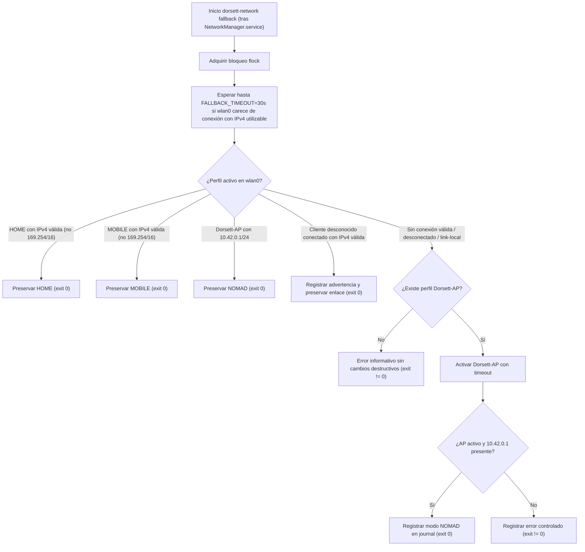

# Arquitectura y Operación de Redes — Proyecto Dorsett

Este documento detalla los tres modos oficiales de conectividad de **Dorsett (`v0.4.0 — Nomad Update`)**, la interacción con `NetworkManager 1.52.1` y Netplan, y la lógica exacta del *fallback* al arrancar.

---

## 1. Principios de diseño de red

1. **Gestor único:** `NetworkManager` controla todas las interfaces (`wlan0`, `eth0`, `lo`). No se ejecutan demonios competidores (`hostapd` manual ni `wpa_supplicant` directo gestionado aparte).
2. **Sin dependencia de Internet:** una red local sin salida WAN (router sin Internet, hotspot sin datos o `Dorsett-AP`) es una red operativa válida. Nunca se valida conectividad haciendo `ping` a servidores externos ni consultas DNS públicas.
3. **Conmutación excluyente en `v0.4.0`:** según `iw list`, la radio admite `1 managed + 1 AP` solo en un canal compartido, cuya estabilidad no está probada. En `v0.4.0`, `wlan0` opera en modo cliente (`HOME`/`MOBILE`) **o** en modo Access Point (`NOMAD`), nunca ambos simultáneamente.
4. **Estabilidad de sesiones:** el servicio de arranque evalúa la red una sola vez dentro de una ventana acotada (`FALLBACK_TIMEOUT=30`). Si `NOMAD` está activo y posteriormente reaparece el router doméstico, Dorsett **no** conmuta automáticamente para no cortar sesiones SSH o TightVNC activas.

---

## 2. Modos oficiales de conectividad

### 2.1 Modo `HOME`

- **Rol:** cliente Wi-Fi en la red doméstica autorizada.
- **Interfaz:** `wlan0`.
- **Perfil:** definido en `HOME_PROFILE` dentro de `/etc/dorsett/network.env` (en la auditoría del `2026-11-24`, perfil con prefijo `netplan-wlan0-`).
- **Autoconexión y prioridad:** habilitada, prioridad `100` (`CONFIRMED`).
- **Direccionamiento:** DHCP (IP observada `192.168.1.52/24`, gateway `192.168.1.1`, métrica `600`).
- **Internet:** opcional.
- **Acceso a servicios:** SSH (`192.168.1.52:22`), TightVNC (`192.168.1.52::5901`), Samba (`\\192.168.1.52`).

### 2.2 Modo `MOBILE`

- **Rol:** cliente Wi-Fi conectado al hotspot del smartphone **Samsung Galaxy A10**.
- **Interfaz:** `wlan0`.
- **Perfil:** definido en `MOBILE_PROFILE` dentro de `/etc/dorsett/network.env`. Puede quedar vacío hasta que se registre el hotspot.
- **Autoconexión y prioridad:** habilitada, prioridad `50`.
- **Direccionamiento:** IPv4 dinámico por DHCP entregado por el smartphone.
- **Internet:** opcional (datos móviles del teléfono).
- **Estado actual (`UNKNOWN`):** el SSID exacto del Galaxy A10 y su política de aislamiento entre clientes (*AP isolation*) aún no han sido verificados. No debe asumirse que perfiles preexistentes desconocidos correspondan al smartphone.

#### Registro interactivo seguro del perfil `MOBILE`

Cuando se conozca el hotspot del Galaxy A10, regístralo en la Raspberry Pi de forma interactiva sin exponer la contraseña en historial o scripts:

```bash
sudo nmcli --ask connection add \
  type wifi \
  ifname wlan0 \
  con-name "Galaxy-A10-Hotspot" \
  ssid "<SSID_GALAXY_A10>" \
  wifi-sec.key-mgmt wpa-psk
```

Luego asigna autoconexión y prioridad `50`:

```bash
sudo nmcli connection modify "Galaxy-A10-Hotspot" \
  connection.autoconnect yes \
  connection.autoconnect-priority 50
```

> **Verificación requerida:** una vez conectado, comprobar que la Tablet X-View o la PC conectadas al mismo hotspot pueden alcanzar a la Raspberry Pi en TCP `22`, `5901` y `445` (algunos hotspots móviles aíslan clientes entre sí).

### 2.3 Modo `NOMAD`

- **Rol:** Raspberry Pi 5 como Access Point autónomo.
- **Nombre de perfil y SSID por defecto:** `Dorsett-AP`.
- **Interfaz:** `wlan0`.
- **Banda y canal:** `2.4 GHz` (`802-11-wireless.band bg`), canal inicial `6` (compatible con dispositivos antiguos de 2.4 GHz como la Tablet X-View).
- **Seguridad:** WPA2-PSK con cifrado CCMP (`wifi-sec.key-mgmt wpa-psk`, `wifi-sec.proto rsn`, `wifi-sec.pairwise ccmp`, `wifi-sec.group ccmp`). Nunca AP abierto.
- **IPv4:** `10.42.0.1/24` con `ipv4.method shared` (NetworkManager invoca `/usr/sbin/dnsmasq` como servidor DHCP local).
- **IPv6:** deshabilitado (`ipv6.method disabled` o `ignore`) para evitar ambigüedad en clientes antiguos.
- **Autoconexión:** deshabilitada (`connection.autoconnect no`), activándose únicamente por *fallback* cuando no hay red autorizada o por orden explícita.

#### Acceso de referencia en modo `NOMAD`

| Servicio | Dirección de referencia | Observaciones |
| :--- | :--- | :--- |
| **SSH** | `10.42.0.1` (puerto `22`) | Método principal de administración |
| **TightVNC** | `10.42.0.1::5901` | Sintaxis de puerto en TightVNC Viewer (Windows 8.1) |
| **Samba** | `\\10.42.0.1` | Acceso al recurso compartido desde Windows/Android |
| **mDNS** | `raspi-ali.local` | Opcional si Avahi y el cliente resuelven sobre `wlan0` en modo AP; la IP es la referencia principal |

---

## 3. Investigación obligatoria de Netplan vs NetworkManager

La auditoría del `2026-11-24` detectó perfiles llamados `netplan-wlan0-*` y `netplan-eth0`. En Debian/Ubuntu recientes con Netplan + NetworkManager, `netplan` genera archivos temporales en `/run/NetworkManager/system-connections/` a partir de YAML en `/etc/netplan/`.

**Antes de modificar o borrar perfiles existentes en producción:**

1. Inspeccionar en modo lectura:
   ```bash
   ls -la /etc/netplan/
   sudo cat /etc/netplan/*.yaml
   sudo ls -la /etc/NetworkManager/system-connections/ /run/NetworkManager/system-connections/
   ```
2. **Regla de oro:** no editar simultáneamente archivos YAML de Netplan y perfiles generados por `netplan-` mediante `nmcli` esperando persistencia idéntica sin comprobar quién posee la configuración; no ejecutar `netplan apply` a ciegas sobre una sesión SSH activa.
3. El perfil `Dorsett-AP` creado por `setup-hotspot.sh` se almacena directamente en NetworkManager (`/etc/NetworkManager/system-connections/`), independiente de Netplan.

---

## 4. Lógica de `dorsett-network fallback` al arrancar



### Criterios de validez de IPv4

Un perfil cliente secundario autoconectado con IPv4 utilizable evita que se active NOMAD. Si carece de IPv4 utilizable, puede ser sustituido por el AP al vencer la ventana.

El script **no** considera suficiente cualquier dirección IP en `wlan0`:

- Verifica el estado de `wlan0` (`GENERAL.STATE` / estado `connected` = `100` con `LC_ALL=C`).
- Descarta direcciones *link-local* `169.254.0.0/16` (fallo de DHCP).
- Diferencia explícitamente si el perfil activo es modo `ap` (`802-11-wireless.mode: ap`) o cliente (`infrastructure`).
- Aplica límite temporal acotado (`FALLBACK_TIMEOUT` + `NMCLI_TIMEOUT`) para evitar esperas infinitas si el DHCP del router es lento.
